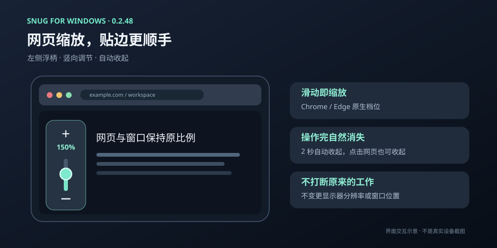
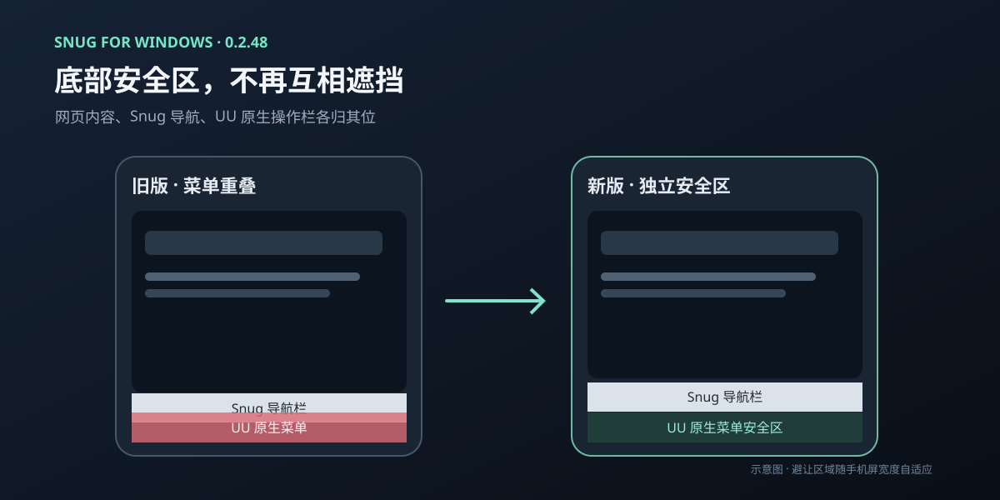
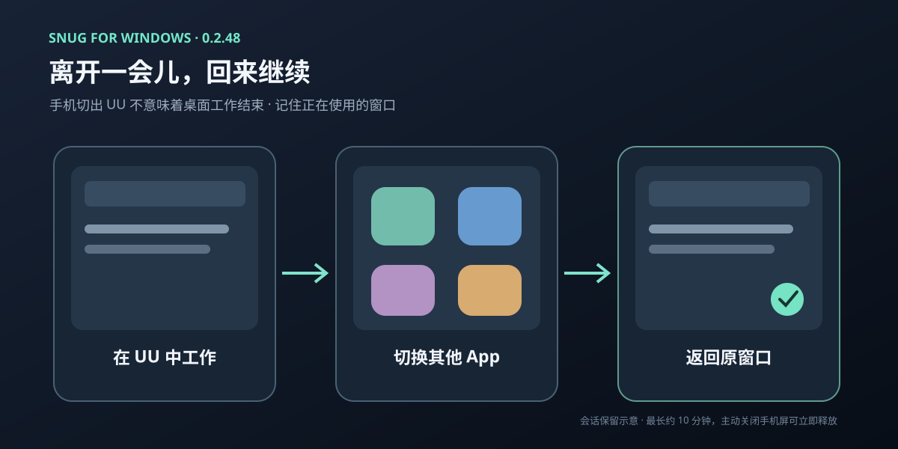

<div align="center">


# Snug for Windows

**A native-grade Windows experience, right on your phone**

Built for UU Remote · Dedicated portrait display · Native gestures · App Library

  [](LICENSE)

[简体中文](README.md) · English

[Download](#download) · [Native experience](#native-experience) · [App Library](#app-library) · [Usage](#usage) · [Development](#development)

</div>

<p align="center">


<br><sub>App Library · Terminal demonstration · ChatGPT desktop</sub>
<br><sub>Actual Windows virtual-display captures; edited time-sampled demonstration, not a UU mobile client recording.</sub>
</p>

Snug for Windows is an independent community port of [Snug](https://github.com/zephyr4123/snug), maintained by [rizetngan](https://github.com/rizetngan). Based on Snug 2.5.0, it uses C# / .NET 10 / WPF. For macOS, visit the upstream project.

## New in 0.2.48 · Built for your phone



**Zoom naturally.** A vertical Chrome/Edge page-zoom rail appears at the left edge and collapses automatically.



**Two toolbars, no collision.** Snug's return bar and app content stay clear of UU's phone controls.



**Step away and come right back.** Switching mobile apps no longer means instantly destroying the Snug phone display.

[Illustrated feature guide (中文)](docs/0.2.48/README.md)

## Download

**0.2.48 release** · Windows x64 (tested on Windows 10 22H2).

**[Download installer (Windows x64)](https://github.com/rizetngan/snug-for-windows/releases/download/v0.2.48/Snug-Setup-0.2.48-x64.exe)** · [Release notes](https://github.com/rizetngan/snug-for-windows/releases/tag/v0.2.48) · [SHA-256 checksums](https://github.com/rizetngan/snug-for-windows/releases/download/v0.2.48/SHA256SUMS.txt) · [Build from source](Platforms/Windows/README.en.md)

Installer: Snug-Setup-0.2.48-x64.exe. Adds a one-handed left-edge Chrome/Edge zoom rail, a mobile-safe area above UU's bottom toolbar, a ten-minute hold of an existing phone display while capture is paused, and Classic/Expanded/Full viewport presets. Explicit UU disconnect may also retain the screen until timeout; turn Phone Screen OFF or quit Snug for immediate release. 325 automated tests passed. Install with standard Windows UAC approval.

Known issue: reopening the UU iOS keyboard without tapping the remote input again may fail to pan the viewport. This also reproduces on the normal computer screen; tap the input again before opening the keyboard.

## PowerShell installation

Paste this into **Windows PowerShell** to download and verify the latest stable GitHub Release, then open its installer with confirmation:

```powershell
$ErrorActionPreference = 'Stop'
$script = Join-Path $env:TEMP 'install-snug.ps1'
Invoke-WebRequest -UseBasicParsing 'https://raw.githubusercontent.com/rizetngan/snug-for-windows/main/scripts/install-windows.ps1' -OutFile $script
& $script
```

The script verifies SHA-256, asks you to disconnect active UU Remote sessions, and only then starts the official installer. The installer requests administrator approval to install the signed virtual display driver and capture-monitor task. No UU session is disconnected automatically.

[Review the PowerShell installer](scripts/install-windows.ps1). To download and verify without installing, replace the last line with `& $script -DownloadOnly`.

## Install with an AI Agent

Copy the following prompt into an Agent authorized to operate your Windows computer:

```text
Install the latest stable version of Snug for Windows on this Windows x64 computer:
https://github.com/rizetngan/snug-for-windows

1. Check the Windows version and architecture, then select the latest stable Snug-Setup-*-x64.exe from this repository's official GitHub Releases. Do not use third-party mirrors or compile the source instead.
2. Download SHA256SUMS.txt from that release and verify the installer before executing it.
3. Check for an existing Snug installation and active UU Remote sessions. Preserve existing settings. If a remote session is active, ask me to disconnect it; never terminate the connection or restart UU on your own.
4. Explain that the installer requests administrator authorization and deploys the bundled signed virtual display driver and SYSTEM-level UU capture-monitor task. Ask for my approval and run the official installer interactively, without disabling Windows protections.
5. Confirm Snug launches and its phone-screen settings are accessible. If UU Remote is missing, tell me that it must be installed on the computer and phone; do not install it without permission.
6. Report the installed version, path, checksum result, startup result, and any remaining steps I need to perform.
```

## Native experience

Ordinary remote desktop software scales the entire Windows desktop into a phone screen, making small text and controls harder to use. Snug creates a dedicated portrait display for UU Remote and fits Windows app windows to it, rather than requiring repeated whole-desktop zooming.

- **Window fitting**: fit the selected window to the phone display, restoring the previous managed window when switching.
- **Text and layout**: adjust text size in supported apps and accommodate minimum window widths.
- **Screenshots and cropping**: enable the optional screenshot control to copy window images to the Windows clipboard and crop them.

<p align="center">


<br><sub>Same test page · Left: original Windows window · Right: Snug phone display (live 0.2.39)</sub>
</p>

Snug adapts the display mode to Chrome's minimum window width and restores the original window position after UU disconnects. These are actual Windows window and virtual-display captures taken during an iPhone connection, not screenshots of the UU mobile client.

### Coding workflow

<p align="center">


<br><sub>Actual terminal · ChatGPT desktop · Return bar</sub>
</p>

Search for a window in the App Library, then open the existing terminal on the phone display. The demonstration uses a local Claude Code CLI version check and Node.js tests without model inference; the virtual display was operated from the PC. The ChatGPT screenshot shows the real desktop workspace during an iPhone + UU connection; profile, workspace name and model label are redacted.

### Touch gestures

| Gesture | Snug phone screen |
| :--- | :--- |
| One-finger swipe | Scroll pages and lists |
| Horizontal swipe | Scroll supported horizontal areas |
| Long press | Long-press interaction |
| Bottom return bar | Return to the App Library |

Gesture behavior depends on the UU touch mode and application compatibility.

## App Library

View running apps, search windows, launch installed apps and switch between windows directly from the phone.

<p align="center">


<br><sub>Running · All · Search for Notepad (virtual-display capture and 0.2.38 local previews)</sub>
</p>

| Action | How |
| :--- | :--- |
| Open a window | Tap its window row |
| Launch an app | Choose an app in All |
| Search | Find apps or window titles |
| New and close | Use the controls on the app card |
| Return to the library | Tap the bottom return bar |

## Phone model fitting

Snug sizes its virtual display to match the selected phone model. The catalog can be synchronized with upstream. Select a model from phone-screen controls or Windows settings; unlisted devices can use custom dimensions.

<p align="center">

<br><sub>Search for a model and view its resolution</sub>
</p>

## Windows settings

Configure the phone model, gestures and optional screenshots on Windows. The About dialog displays the version, independent repository and upstream credits.

<p align="center">


<br><sub>Settings · About (actual 0.2.39 application UI)</sub>
</p>

## Usage

1. Install [UU Remote](https://uuyc.163.com/) on both devices; install and launch Snug on the Windows computer.
2. Select your phone model and enable the phone display in Settings.
3. Connect through UU Remote, select Snug Phone from the display list and use screen-touch mode.
4. Choose a window from the App Library; tap the bottom return bar to return to the library.
5. **Starting in 0.2.42:** switch between the primary display and Snug Phone directly in UU; the phone display stays available during the session. Use Restore Window in the App Library if you want to return a managed window. Disconnecting or disabling Phone Screen restores managed windows and releases the virtual display.

[Full Windows guide](Platforms/Windows/README.en.md) · [Screenshot provenance](Assets/WindowsMedia/README.md)

## Validation and limitations

November 18, 2026: 276 core tests, Release build, and iPhone 13 Pro + UU Remote acceptance passed: monitor recovery, stable display, Chrome fitting, exit/re-entry, and window restoration and display release after disconnect.

The controlling device type and actual streamed display identity remain unknown. Some app capture and zoom behavior, multi-monitor restoration and the full gesture matrix require broader testing.

[Acceptance report](Platforms/Windows/CAPTURE_MONITOR_RECOVERY_20261118.md) · [Changelog](Platforms/Windows/CHANGELOG.md) · [Limitations](Platforms/Windows/README.en.md)

## Development

The default `main` branch is the Windows maintenance entry point. The platform implementation is under [Platforms/Windows](Platforms/Windows/).

```powershell
git clone https://github.com/rizetngan/snug-for-windows.git
cd snug-for-windows/Platforms/Windows
.\build-snug.cmd
.\run-snug.cmd
```

[Build, test and package](Platforms/Windows/README.en.md) · [Porting status](Platforms/Windows/PORTING_STATUS.md)

## Credits and license

Thanks to [Snug / zephyr4123](https://github.com/zephyr4123/snug), [UUyc-companion / AoyamaShou](https://github.com/aoyamashou/UUyc-companion), upstream contributors, [Virtual Display Driver](https://github.com/VirtualDrivers/Virtual-Display-Driver) and [NefCon](https://github.com/nefarius/nefcon).

Original history, macOS source and copyright notices are preserved. This independently maintained and released Windows port is not an official upstream Windows build or an official UU Remote product.

[MIT License](LICENSE) · [Third-party notices](Platforms/Windows/installer/THIRD_PARTY_NOTICES.md)
