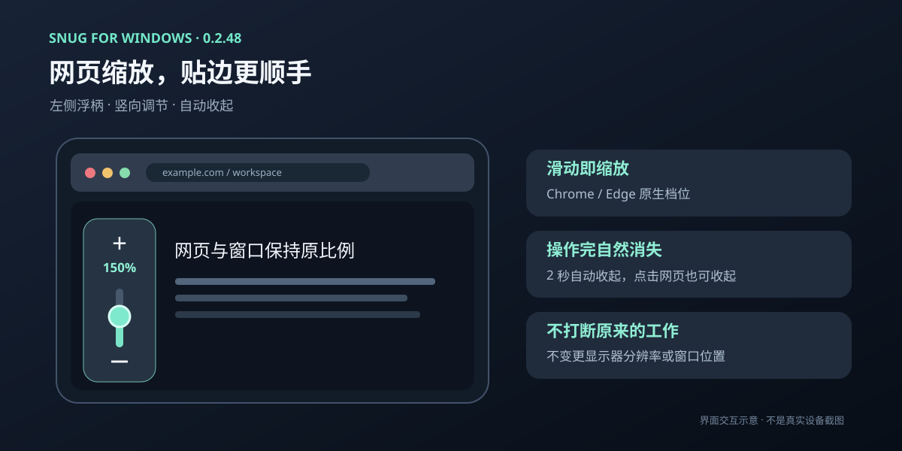
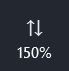
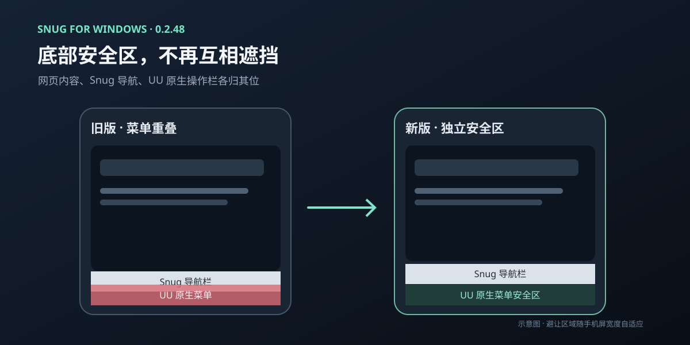
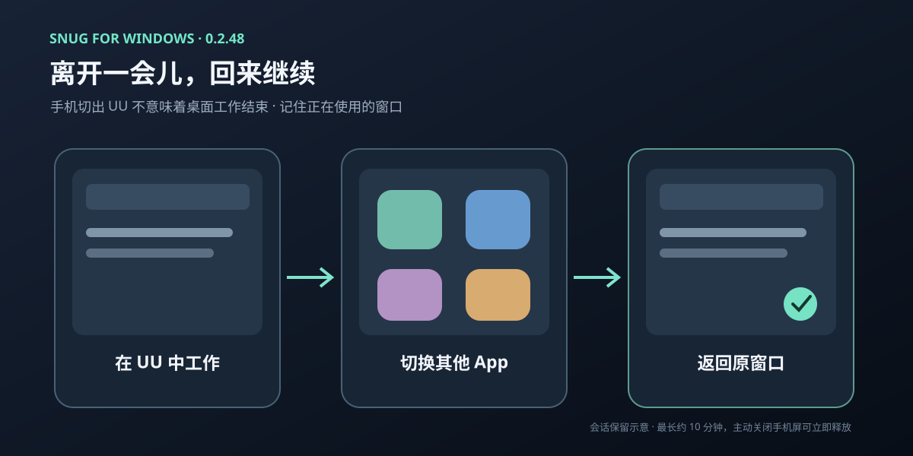

# Snug for Windows 0.2.48

## 让桌面应用在手机上真正顺手

把浏览器、代码编辑器或 AI 工作窗口放进专属手机屏，并不意味着要把整台电脑塞进手机。

0.2.48 关注三个常见但影响体验的细节：网页缩放时的小控件、UU 与 Snug 底栏争夺空间，以及手机暂时切到其他 App 后需要重新找回工作状态。

真实 WPF 控件渲染预览（左：收起，右：展开；非 UU 手机端截图）：

  
  &nbsp;&nbsp;&nbsp;&nbsp;&nbsp;
  

### 1. 单手调整浏览器，不打断阅读

在 Snug 手机屏打开 **Chrome 或 Edge**，左侧出现一个小浮柄。点击展开竖向缩放条，上滑放大、下滑缩小；也可以点加减号，或一键恢复 100%。

调整后约 2 秒自然收起。再次点击浮柄可展开，点击浮层外的网页或向左滑动也能收起。紧凑的深色不透明控件让百分比和按钮在手机画面里更容易辨认。

它使用 **浏览器原生网页缩放**，而不是对远程桌面画面二次放大：页面排版跟随浏览器变化，Snug 虚拟屏分辨率、其他窗口及原桌面保持不变。

**适用场景**：移动端浏览长报告、在网页后台处理表单、打开 AI 对话或阅读代码文档时，想一只手把内容放大一点。

### 2. UU 的菜单和 Snug 导航，不再挤在一处

原先 Snug 底部导航紧贴虚拟屏底边，恰好容易落在 UU 手机端底部「展开所有窗口 / 显示桌面 / 键盘 / 操作」工具栏后面。键盘弹出后菜单位置变化，看起来问题才被临时解决。

现在 Snug 会按当前虚拟屏宽度预留一块 **UU 底部安全区**，同时调整：

- Snug 自己的返回导航位置；
- 放入手机屏的 Windows 应用实际可用高度。

两者共用同一套布局尺寸，不再只是把按钮往上挪、却让网页输入框继续被盖住。这个安全区只影响 Snug 管理的竖屏，不改变物理主显示器的分辨率。

**适用场景**：网页底部输入、聊天回复、浏览器滚动、切换键盘时，随时能触达 Snug 返回入口，也能使用 UU 的原生菜单。

### 3. 手机临时离开，回来继续原来的窗口

手机切换到微信、查看通知或临时处理其他事情时，UU 的视频捕获可能暂停。0.2.47 曾把这种捕获停止当成会话退出，导致虚拟屏和受管理窗口被回收。

0.2.48 将视频捕获暂停与 Windows 虚拟屏生命周期分离：**已有的 Snug 手机屏最多保留约 10 分钟**；回到 UU 后优先复用原显示器与窗口位置，不让一次普通的切 App 变成重新设置手机屏。

当前 UU 没有向 Snug 提供可验证的「明确退出」信号，因此即便主动断开 UU，也可能保留屏幕至超时；如需立即释放，可以在 Snug 设置中关闭「手机屏」或退出 Snug。应用窗口会按原有恢复流程还原。

**适用场景**：手机查看验证码、接消息、短暂切换其他 App，回来继续使用电脑上的浏览器、AI 工具和开发环境。

### 4. 新 UU 显示比例更容易适配

针对新版 UU 可能出现的上下留白、内容被遮挡等情况，设置中提供 **标准（旧版）/ 扩展画面 / 全面屏** 三种比例选择。它们统一影响虚拟显示器公布的显示模式、窗口布局与触控映射；不会在当前远控会话中突然重建虚拟显示器。

默认保留旧比例。不同 UU iOS 版本的工具栏占用空间不一样，可根据手机实际画面选用最合适的档位。

### 完整验收要点

连接 UU → 选中 Snug Phone → 打开 Chrome/Edge → 展开左侧缩放条 → 改变比例并观察自动收起 → 不调键盘时验证 Snug 导航和 UU 底栏都能点击 → 切到其他手机 App 约 1 分钟再返回 → 验证还是原来的窗口。

本版本通过 **325/325 项核心自动化测试**，Windows Release 构建零警告、零错误。示意图为产品交互说明而非设备截图；手机端 UI 可用性、后台切换和不同型号比例仍以真实 UU 操作结果为最终验收依据。

### 安装与来源

- 适用：Windows x64，配合 UU 远程。
- 包含：.NET 运行时、签名虚拟显示驱动、UU 捕获监控。
- 首次安装或更新可能需要 Windows 管理员授权。
- 安装前先恢复 Snug 管理的窗口并退出 Snug。
- 项目是 [Snug 原项目](https://github.com/zephyr4123/snug) 的独立 Windows 移植版本，并非 UU 或原作者的官方产品。

[项目主页](../../README.md) · [English](../../README.en.md) · [更完整的 Windows 说明](../../Platforms/Windows/README.md)

### Agent 安装说明（可复制）

请在 Windows 上安装 Snug for Windows 0.2.48：从 GitHub 正式 Release 下载 Snug-Setup-0.2.48-x64.exe 及 SHA256SUMS.txt，先校验 SHA-256；确认 Snug 管理的窗口已安全还原，并通过 Snug 自身的退出操作关闭旧版本；按标准 Windows UAC 授权安装。保留现有设置与签名虚拟显示驱动，不强行关闭其他程序，不在 UU 远程连接进行中重启 UU。安装后核对版本与手机端三项功能。

Release 地址：https://github.com/rizetngan/snug-for-windows/releases/tag/v0.2.48
