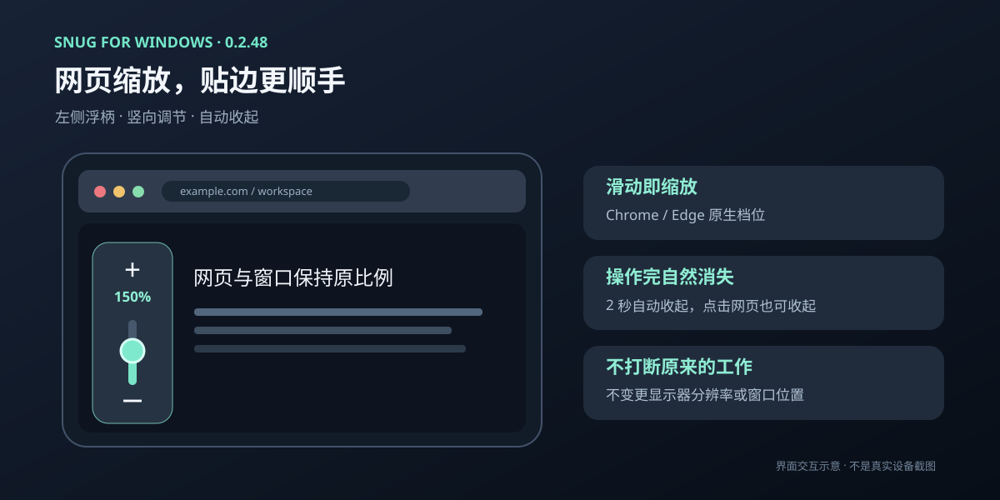
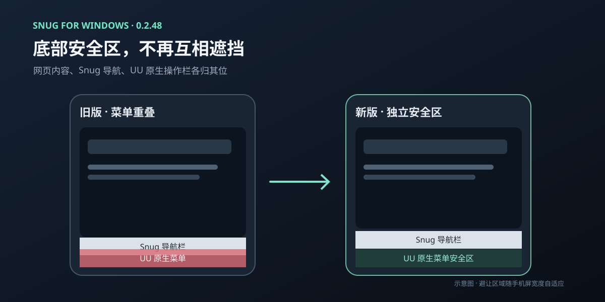
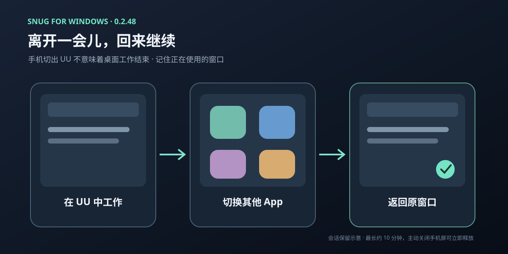

# Snug for Windows 0.2.48

**一次更新，解决手机端操作最容易卡住的三个细节。**

### 新增与修复

- **浏览器侧边缩放**：Chrome / Edge 新增左侧单手竖向浮条，原生缩放 50%～200%，+ / − / 100% 重置；完成操作约 2 秒收起，支持外部点击和再次点击。
- **UU 底栏安全区**：Snug 返回导航和应用可用高度共同避开 UU 手机操作栏，无需再依靠调起键盘错开菜单。
- **后台继续使用**：手机切到其他 App，短暂停止画面捕获时不立即销毁 Snug 虚拟屏；最多保留约 10 分钟，返回 UU 后复用原窗口。
- **分辨率校准**：标准 / 扩展 / 全面屏三档，对齐虚拟显示器、窗口布局及触控映射。变更仅在下一次创建手机屏时生效。
- 保留之前的窗口恢复、快速连接、主屏与手机屏切换、截图和输入优化。

### 实际使用场景

阅读网页或 AI 对话时从左侧随手缩放；聊天回复时 Snug 导航与 UU 键盘/操作菜单不再重叠；手机看消息后返回同一个远程工作窗口。

### 验证与已知边界

325/325 项核心自动化测试通过，Release 构建无警告。图示为产品示意，非真实手机截图。

UU 的捕获暂停并不等于明确退出：0.2.48 优先避免误销毁正在使用的虚拟屏，因此主动断开 UU 时也可能继续保留屏幕，最长约 10 分钟。需要马上释放时关闭 Snug「手机屏」或退出 Snug。新版手机菜单布局请以实际 iPhone 和 UU 版本验收为准。

安装器包含 .NET 运行时和签名虚拟显示驱动；安装器本身未签名，Windows 管理员授权可能出现。更新前恢复窗口并退出 Snug。

---

## English

This release makes UU Remote feel more natural on a phone:

- **One-handed browser zoom:** a left-edge vertical rail for Chrome/Edge, native 50–200% page zoom, plus/minus and reset; it collapses after about 2 seconds or an outside click.
- **UU bottom-menu safe area:** Snug's return bar and the managed app window share a proportional safe area above the phone's own UU controls.
- **Background continuity:** switching to another phone app pauses capture without destroying the already-created Windows virtual display. Return to reuse the same managed window within the retention period (up to 10 minutes).
- **Mobile viewport presets:** Classic, Expanded and Full, applied consistently to virtual display modes, app bounds and touch geometry at the next screen creation.

325/325 core tests passed; Release built without warnings. Illustrations are UI concepts, not mobile client screenshots. The UU-controlled PC cannot always distinguish a temporary capture pause from an explicit remote disconnect, so the display may remain until manual release or timeout. The unsigned installer requires Windows administrator consent, while its bundled VDD driver is signed.

Independent community-maintained Windows port of [Snug](https://github.com/zephyr4123/snug); not an upstream or UU official release.