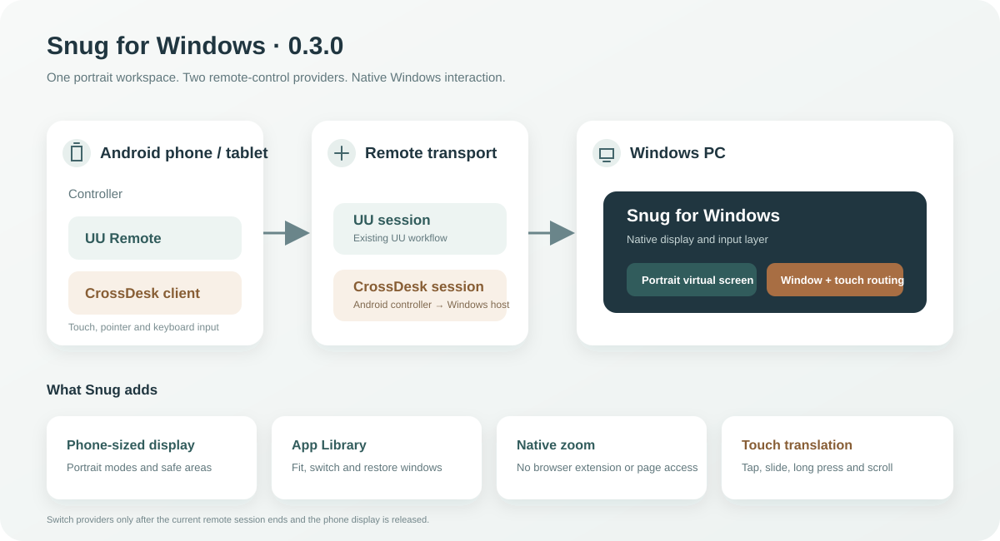
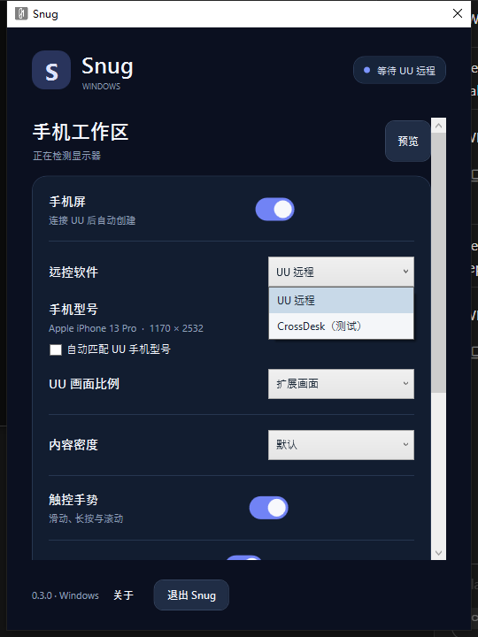
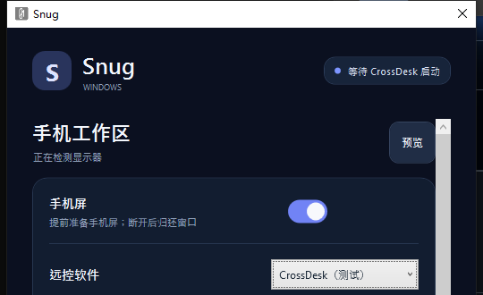

# Snug for Windows 0.3.0

Windows x64 · Candidate · 426 core tests passing

**One Snug phone workspace, two remote-control providers: UU Remote and CrossDesk.** Browser zoom remains native to Windows; no browser extension is required.

## What changed

- **CrossDesk mode:** run the CrossDesk host on Windows and the CrossDesk controller on an Android phone or tablet. Snug creates the portrait workspace and translates CrossDesk absolute touch input into native taps, swipes, long presses and scrolling.
- **UU remains supported:** existing settings continue to use UU by default. End the current session and release the phone display before switching providers.
- **Extension-free zoom:** removes the browser extension, Native Messaging host and local relay. Chrome / Edge tab identity is read through Windows UI Automation; zoom uses native relative shortcuts. Snug does not read page content or URLs.
- **Optional UU model matching:** off by default; only a single phone controller with an exact model match is eligible. Manual selections are preserved.
- **Generic aspect presets:** phones 20:9, 19.5:9 and 16:9; tablets 4:3 and 16:10.
### Interface preview

## Runtime layout

| Side | UU mode | CrossDesk mode |
|---|---|---|
| Android phone / tablet | UU Remote controller | CrossDesk controller |
| Windows PC | UU Remote host + Snug | CrossDesk host + Snug |
| Snug | Portrait virtual display, window fitting, zoom and touch | Same, plus CrossDesk absolute-touch translation |

The CrossDesk Android app is a controller, not a remote host. To control Windows, the CrossDesk host must run on the Windows PC.

## Requirements

- Windows x64; verified on Windows 10 Pro 22H2 (build 19045)
- Snug installer bundles the signed VDD 25.7.23 driver, NefCon 1.21.1 and runtime
- First-time Snug virtual-display driver deployment requires Windows administrator approval. The candidate app can run from a per-user folder when the driver is already installed.
- The current installer is not code-signed, so Windows may show a SmartScreen warning. Verify the SHA-256 published with the GitHub release before running it.
- CrossDesk mode requires the Windows desktop app and Android client. CrossDesk Service is only needed for lock-screen/sign-in-screen control; normal desktop control does not require it.

## CrossDesk setup

1. Install CrossDesk on Windows and Android; complete the first-run privacy consent on Android.
2. In Snug Settings, select CrossDesk, choose the phone model and enable the phone screen. Wait until the portrait display is ready.
3. Only then start the CrossDesk Windows host. If it is already running, exit it and restart after the Snug display is ready.
4. Connect the Android CrossDesk controller to Windows by device ID or LAN IP, then select the Snug display.
5. Use the phone to operate windows; Snug handles taps, scrolling, long press and zoom.
6. End the CrossDesk session before restoring windows; turn off the phone screen before switching back to UU.

**Direct LAN:** CrossDesk uses TCP port 52888 by default. Windows Firewall must allow inbound CrossDesk traffic on the Private profile; do not open it on Public networks. Device-ID mode requires access to the signaling server.

## Native zoom, no extension

Chrome / Edge no longer depend on a browser extension, Native Messaging or a local HTTP service. Snug identifies the foreground window and active tab, then applies native relative zoom shortcuts; reset uses the browser's configured default. It rechecks the target before each action and never applies a previous tab's percentage to the current tab. Other supported desktop apps continue to use their native zoom commands.

## Validation status

- 426 / 426 core tests passing
- Release build: 0 warnings, 0 errors
- Verified on Windows 10 Pro 22H2
- CrossDesk Windows / Android 1.7.7 deployed; real mobile connection, touch, window restoration and UU regression are still in final acceptance

Before stable release, the full CrossDesk mobile session and the existing UU workflow will be tested: taps, swipes, long press, browser-tab switching, zoom, disconnect and window restoration.

## Related
- [0.3.0 release notes](RELEASE_NOTES.md)\r\n- [Package SHA-256 checksums](SHA256SUMS.txt)

- [Windows installation and build guide](../../Platforms/Windows/README.en.md)
- [Changelog](../../Platforms/Windows/CHANGELOG.md)
- [Third-party notices](../../Platforms/Windows/installer/THIRD_PARTY_NOTICES.md)