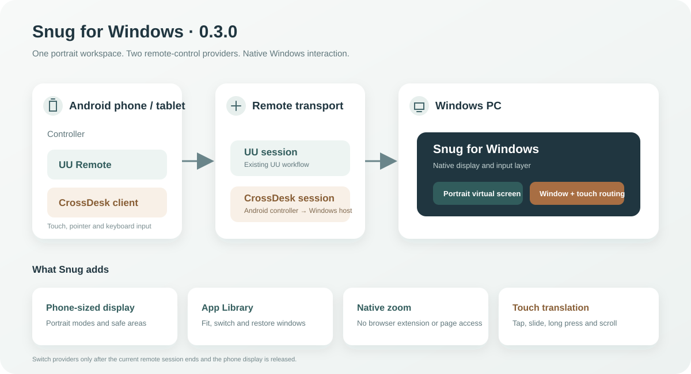
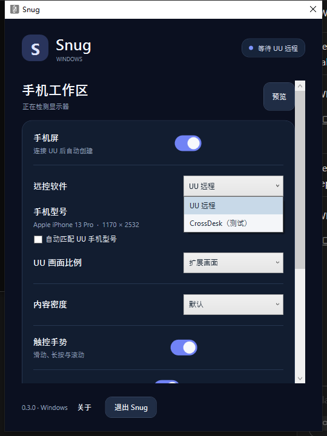
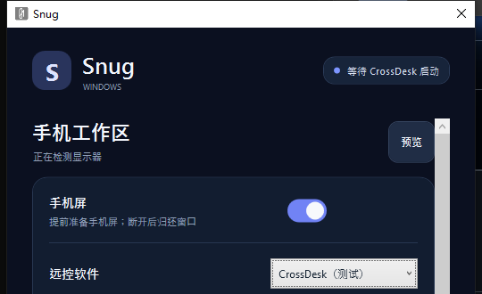

# Snug for Windows 0.3.0

Windows x64 · 候选版 · 426 项核心测试通过

**同一个 Snug 手机工作区，支持 UU Remote 与 CrossDesk 两种远控方式。** 浏览器缩放继续采用 Windows 原生方案，不需要安装浏览器扩展。

## 这一版的变化

- **CrossDesk 模式**：Windows 运行 CrossDesk 主机，Android 手机/平板运行 CrossDesk 控制端；Snug 创建竖屏工作区，并把 CrossDesk 的绝对触控事件转换为原生点击、滑动、长按和滚动
- **保留 UU 模式**：已有配置默认继续使用 UU；切换远控方式前必须先结束当前会话并释放手机屏
- **无浏览器扩展缩放**：移除扩展、Native Messaging 和本地通信宿主；Chrome / Edge 通过 Windows UI Automation 识别当前标签页，再执行原生相对缩放，不读取网页内容或 URL
- **UU 机型自动匹配**：可选、默认关闭；只在单个手机控制端且型号精确匹配时使用，不覆盖手动选择
- **通用比例预设**：手机 20:9、19.5:9、16:9；平板 4:3、16:10
### 界面预览

## 运行结构

| 端 | UU 模式 | CrossDesk 模式 |
|---|---|---|
| Android 手机 / 平板 | UU Remote 控制端 | CrossDesk 控制端 |
| Windows 电脑 | UU Remote 被控端 + Snug | CrossDesk 主机 + Snug |
| Snug 负责 | 竖屏虚拟显示、窗口铺放、缩放与触控 | 同左，并接管 CrossDesk 绝对触控输入 |

CrossDesk Android 客户端是控制端，不是远程主机。要控制 Windows，CrossDesk 主机必须运行在 Windows 电脑上。

## 安装要求

- Windows x64；当前实测环境为 Windows 10 Pro 22H2（19045）
- Snug 安装包包含签名 VDD 25.7.23、NefCon 1.21.1 和运行时
- 首次部署 Snug 虚拟显示驱动需要 Windows 管理员授权；已有驱动的候选版可从用户目录运行
- 当前安装程序尚未进行代码签名，Windows 可能显示 SmartScreen 提示；从 GitHub 下载后先核对 SHA-256，再继续运行
- CrossDesk 模式需要 Windows 桌面版和 Android 客户端；CrossDesk Service 只用于锁屏/登录界面远控，普通桌面控制不需要安装该服务

## CrossDesk 使用流程

1. Windows 和 Android 两端安装 CrossDesk；Android 完成首次隐私授权
2. 先在 Snug 设置中选择 CrossDesk、选定机型并开启手机屏，等待竖屏显示器准备完成
3. 再启动 Windows CrossDesk 主机；如果主机已经运行，先退出，再在手机屏准备完成后重新启动
4. Android CrossDesk 通过设备 ID 或局域网 IP 连接 Windows，并选择 Snug 手机显示器
5. 在手机上操作窗口；Snug 负责点击、滚动、长按和缩放
6. 退出 CrossDesk 会话后，Snug 恢复受管理窗口；切回 UU 前先关闭手机屏

**局域网直连：** CrossDesk 默认使用 TCP 52888。Windows 防火墙需要允许 CrossDesk 在专用网络接收入站连接；不要为此开放公用网络。设备 ID 模式需要信令服务器可达。

## 无扩展缩放

Chrome / Edge 不再依赖浏览器扩展、Native Messaging 或本地 HTTP 服务。Snug 只识别当前窗口和活动标签页，并通过浏览器原生快捷键执行相对缩放；重置使用浏览器默认值。切换标签页或窗口时会重新确认目标，不把上一标签页的百分比套用到当前标签页。其他支持的桌面应用继续使用各自的原生缩放方式。

## 验证状态

- 426 / 426 核心测试通过
- Release 构建：0 警告、0 错误
- Windows 10 Pro 22H2 实测
- CrossDesk Windows / Android 1.7.7 已部署；实际移动端连接、真机触控、窗口恢复和 UU 回归仍在最终验收中

正式发布前会完成 CrossDesk 真机连接、点击/滑动/长按、浏览器标签切换、缩放、断开恢复，以及原有 UU 全流程回归。

## 相关资料
- [0.3.0 发布说明](RELEASE_NOTES.md)\r\n- [安装包 SHA-256 校验值](SHA256SUMS.txt)

- [Windows 安装与构建说明](../../Platforms/Windows/README.md)
- [更新记录](../../Platforms/Windows/CHANGELOG.md)
- [第三方许可](../../Platforms/Windows/installer/THIRD_PARTY_NOTICES.md)